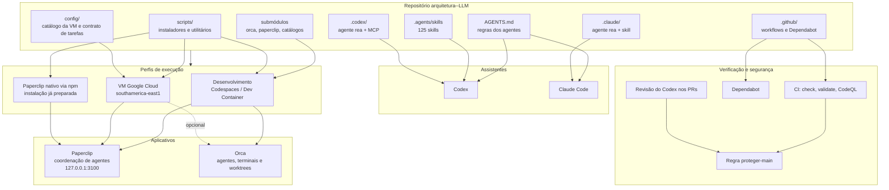
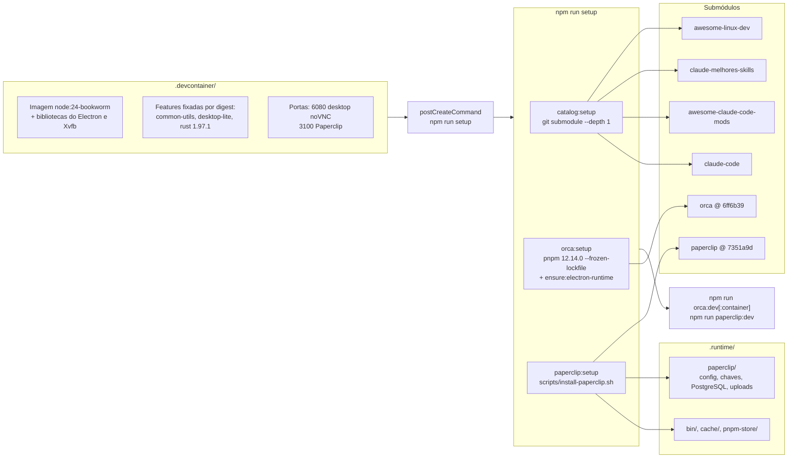
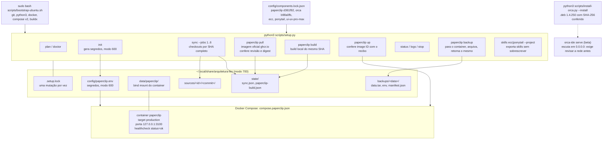
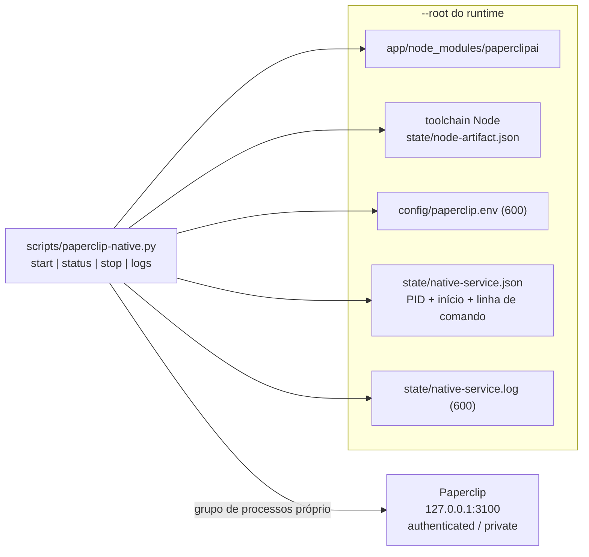
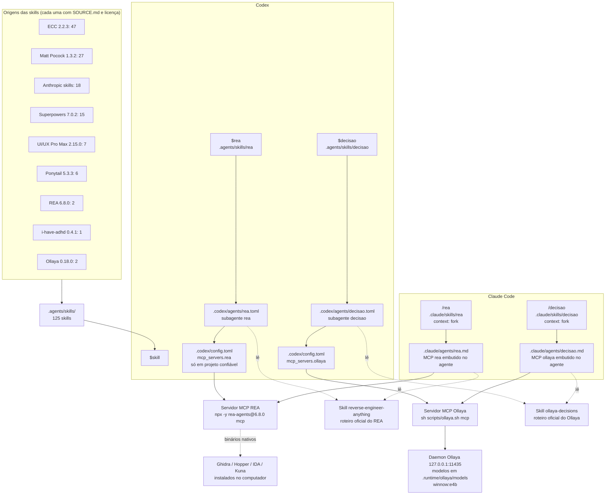
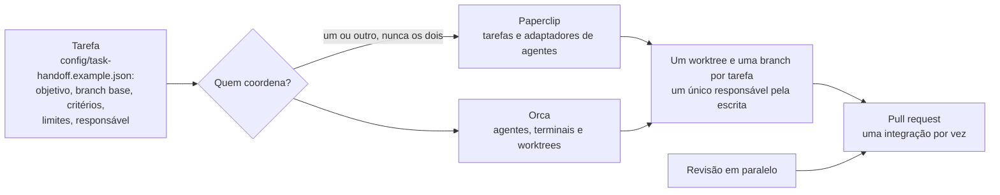
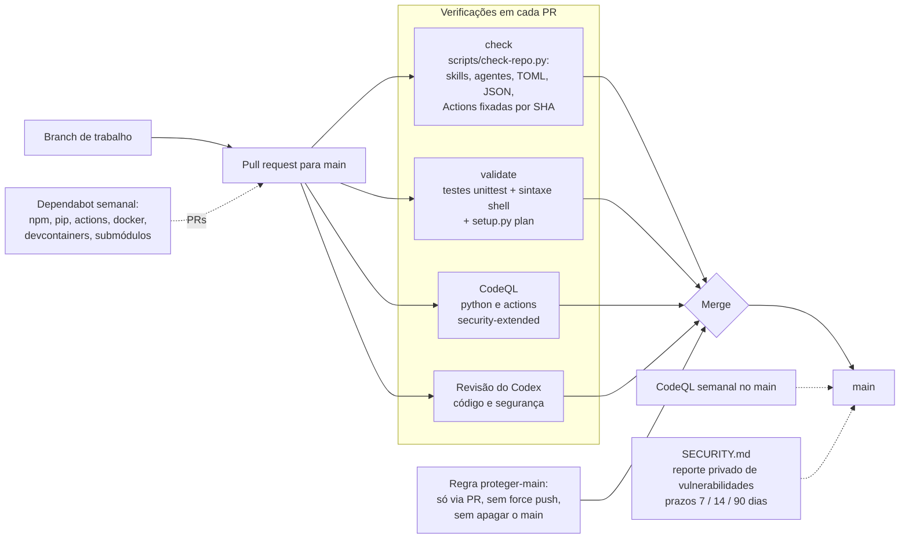
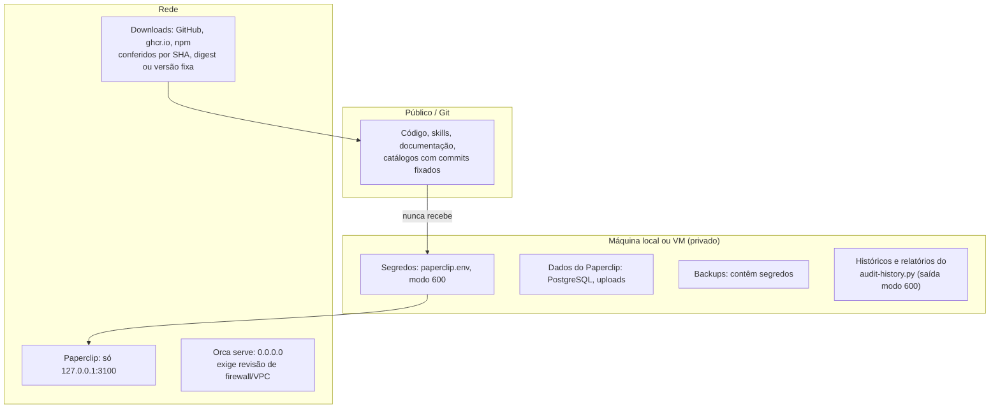

# Arquitetura

Este repositório reúne, num só lugar, o ambiente de trabalho com agentes de IA:
dois aplicativos de orquestração (Paperclip e Orca), um catálogo de skills e
agentes para Codex e Claude Code, e a esteira de verificação e segurança que
protege o `main`. Os diagramas abaixo usam Mermaid e aparecem desenhados no
GitHub.

## 1. Visão geral

| Camada | Onde fica | Função |
| --- | --- | --- |
| Instruções | `AGENTS.md` | Regras para qualquer agente: mudança mínima completa, português, segurança, nada de segredos no Git |
| Skills | `.agents/skills/` | 125 skills de 9 origens, lidas pelo Codex ao abrir o projeto |
| Agentes | `.codex/`, `.claude/` | Agente `rea` de engenharia reversa e agente `decisao` (Ollaya, winnow:e4b), cada um com servidor MCP |
| Aplicativos | `paperclip/`, `orca/` (submódulos) | Orquestração de agentes |
| Instalação | `scripts/`, `config/`, `compose.paperclip.json`, `.devcontainer/` | Três perfis de execução |
| Verificação | `.github/`, `tests/`, `SECURITY.md` | CI, análise estática, dependências e política de segurança |

## 2. Perfil de desenvolvimento (Codespaces / Dev Container)

Tudo que é gerado fica em `.runtime/`, ignorada pelo Git.

- **Orca**: `npm run orca:dev` no desktop local; `orca:dev:container` desativa o
  sandbox do Electron apenas dentro do contêiner.
- **Paperclip**: `install-paperclip.sh` exige Node 24.11+, pnpm 9.15.4 (via
  Corepack) e Rust; aplica as migrações e grava os dados em `PAPERCLIP_HOME`
  (padrão `.runtime/paperclip`). `start-paperclip.sh` sobe a aplicação em
  `http://localhost:3100`.
- **Utilitários npm**: `npm run ecc` e `ecc:canvas` (ECC 2.2.3), `npm run rea` e
  `rea:setup` (REA 6.8.0), `npm run ollaya:install` e `ollaya` (Ollaya 0.18.0
  em `.runtime/ollaya`), `npm run check`.

## 3. Perfil da VM Google Cloud

Executado na VM Ubuntu 24.04 por `scripts/setup.py`, que usa só a biblioteca
padrão do Python. O runtime fica fora do repositório.

Proteções do `setup.py`:

- recusa runtime em `/`, no diretório pessoal ou dentro do repositório;
- recusa symlinks em segredos, locks, estado e destinos de skills;
- comandos externos sempre por lista de argumentos, sem shell;
- segredos nunca passam pelo `sudo` nem aparecem nas saídas;
- `up` só inicia a imagem cujo ID confere com o recibo de `pull` ou `build`.

Recuperação e atualização: [OPERACAO.md](OPERACAO.md). Instalação passo a
passo: [INSTALACAO_GOOGLE_VM.md](INSTALACAO_GOOGLE_VM.md).

## 4. Paperclip nativo (npm)

Caminho alternativo, registrado em [PAPERCLIP_NATIVO.md](PAPERCLIP_NATIVO.md),
para uma instalação npm já preparada.

O controlador só sinaliza o processo cuja identidade (PID, tempo de início e
linha de comando) confere com o registro, e um lock impede controles
concorrentes.

## 5. Camada de agentes: skills, agentes e MCP

- No **Codex**, o servidor MCP fica no `.codex/config.toml` do projeto, porque
  agentes do Codex não podem ter servidores próprios; as ferramentas do REA
  aparecem também na sessão principal.
- No **Claude Code**, cada servidor existe só dentro do seu agente (`rea`, `decisao`).
- O agente `decisao` só decide: devolve a resposta tipada e a probabilidade, e o
  que fica abaixo dos limites da skill vai para revisão humana.
- Skills de terceiros com alterações locais (correções de segurança e de bugs)
  estão listadas nos `SOURCE.md` de `.agents/ui-ux-pro-max/` e
  `.agents/anthropic-skills/`.

## 6. Orquestração de trabalho

O contrato de passagem proíbe por padrão chamadas pagas, deploy, exclusões e
mudanças de credenciais (`external_actions`), e limita a concorrência a
`max_workers: 3`. Detalhes em [ORQUESTRACAO.md](ORQUESTRACAO.md).

## 7. Verificação, segurança e entrega

- Todos os workflows rodam com `contents: read`, Actions fixadas por SHA e
  `persist-credentials: false`.
- Revisões e correções de segurança ficam registradas em
  [REVISAO_SEGURANCA.md](REVISAO_SEGURANCA.md).

## 8. Fronteiras de confiança e dados

Regras que valem em todos os perfis, do `AGENTS.md`:

- nada de chaves, históricos de chats, bancos, URLs de pairing ou backups no Git;
- serviços do perfil de VM só em loopback; Orca remoto exige revisão da rede;
- nenhum recurso Google, serviço público, agente pago ou exclusão sem autorização;
- fontes fixadas por SHA completo; mudança de versão exige evidência e revisão.

## 9. Mapa de arquivos

| Caminho | Conteúdo |
| --- | --- |
| `AGENTS.md` | Instruções para agentes |
| `SECURITY.md` | Política de segurança e reporte privado |
| `README.md` | Uso de cada integração |
| `package.json` | Comandos `npm run` (setup, orca, paperclip, ecc, rea, ollaya, check) |
| `compose.paperclip.json` | Serviço Paperclip do perfil de VM |
| `config/components.lock.json` | Componentes do perfil de VM, fixados por SHA |
| `config/task-handoff.example.json` | Contrato de passagem de tarefas |
| `scripts/setup.py` | Gerenciador do perfil de VM |
| `scripts/bootstrap-ubuntu.sh` | Pré-requisitos da VM (root) |
| `scripts/install-orca.py` | Download e instalação verificada do Orca |
| `scripts/install-paperclip.sh`, `start-paperclip.sh`, `paperclip-env.sh` | Paperclip no perfil de desenvolvimento |
| `scripts/paperclip-native.py` | Controle do Paperclip nativo |
| `scripts/audit-history.py` | Leitor local de históricos (links e menções ao REA) |
| `scripts/check-repo.py` | Verificação estrutural usada pela CI |
| `tests/` | Testes do instalador, do leitor de históricos, da verificação e das correções em skills |
| `.agents/skills/` | Skills; `.agents/<origem>/` guarda SOURCE.md e licenças |
| `.codex/`, `.claude/` | Agentes e skills `rea` e `decisao` |
| `scripts/ollaya.sh` | Instala e roda o Ollaya fixado, só em loopback e em `.runtime/ollaya` |
| `.devcontainer/` | Ambiente de Codespaces |
| `.github/workflows/` | `check`, `validate`, `codeql` |
| `.github/dependabot.yml` | Atualizações de dependências |
| `docs/` | Guias, operação, revisões e esta arquitetura |
